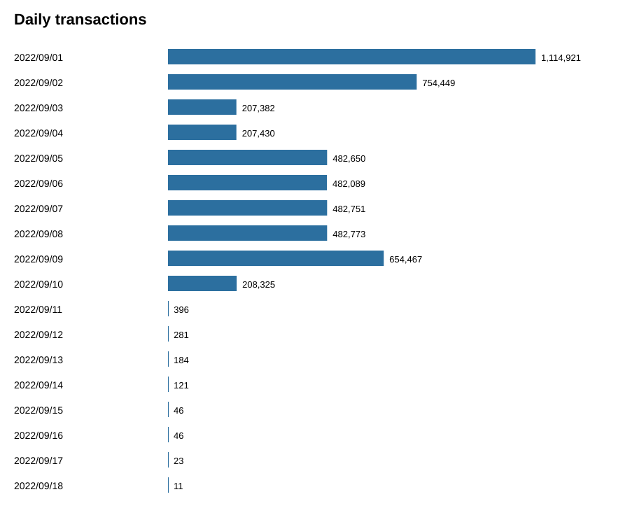
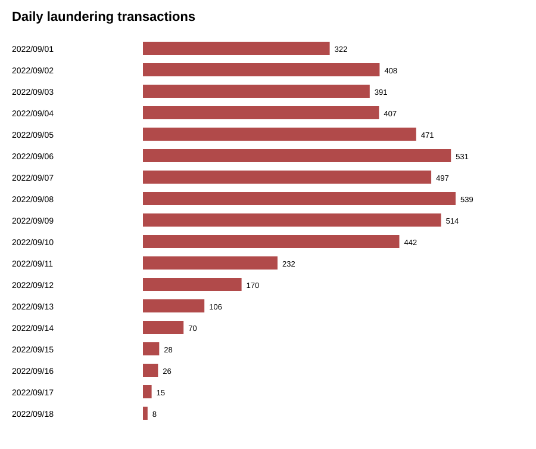
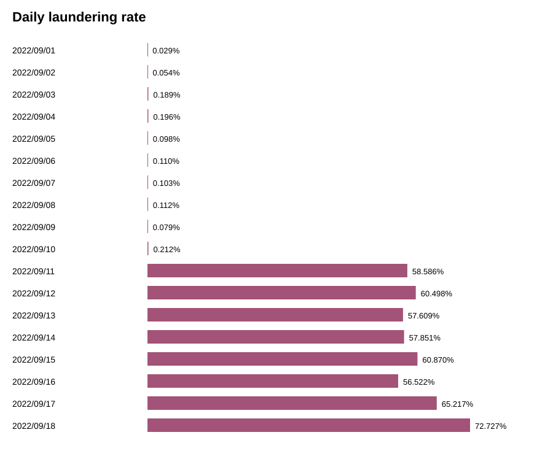
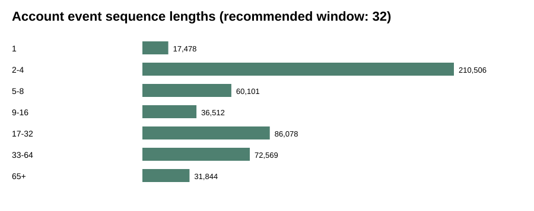
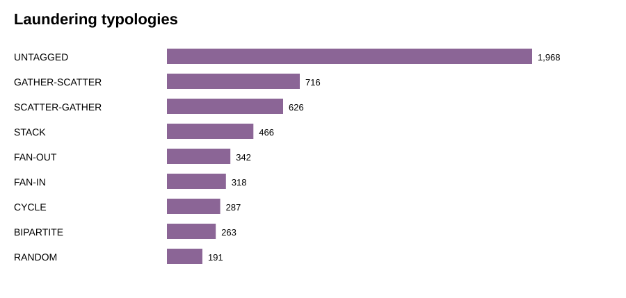

# HI-Small EDA

Render this file in GitHub or a Markdown preview to display the figures from `figures/`.

## Check size and time coverage

- Read 5,078,345 transactions across 515,088 accounts; flag 5,177 laundering transactions (0.1019%).
- Cover 2022/09/01 through 2022/09/18; the source timestamps do not specify a time zone.
- Check source columns: Timestamp, From Bank, Account, To Bank, Account, Amount Received, Receiving Currency, Amount Paid, Payment Currency, Payment Format, Is Laundering. The two Account columns identify the sender and receiver, respectively.
- Check missing values: zero in every column.
- Inspect the tail after 2022-09-10: 1,108 transactions, including 655 laundering transactions.
- Split the main September 1–10 period by elapsed time into 60% train, 20% validation, and 20% test. Keep September 11 onward as a separate tail audit set.

| split | transactions | laundering | rate |
| --- | ---: | ---: | ---: |
| tail | 1,108 | 655 | 59.1155% |
| test | 862,792 | 956 | 0.1108% |
| train | 3,248,921 | 2,530 | 0.0779% |
| valid | 965,524 | 1,036 | 0.1073% |

### Plot daily activity

## Check account sequences

- Count sender and receiver events; each transaction yields two account events.
- Record event-count quantiles across all accounts: {'min': 1, 'p50': 6, 'p90': 51, 'p95': 70, 'p99': 119, 'max': 169756}.
- Record training-period account event-count quantiles: {'min': 1, 'p50': 5, 'p90': 32, 'p95': 43, 'p99': 72, 'max': 101913}.
- Select a fixed window length of 32 from 16, 32, and 64 using the training-period 90th percentile.

## Check amounts and payment formats

- Record paid-amount minimum 1e-06, mean 4.50927e+06, and maximum 1.0463e+12.
- Sample every 50th row for a deterministic scale check (101,567 rows): p50=1407.06, p95=611701, p99=1.27801e+07.
- Aggregate historical amounts only within the same currency.

| payment format | transactions |
| --- | ---: |
| Cheque | 1,864,331 |
| Credit Card | 1,323,324 |
| ACH | 600,797 |
| Cash | 490,891 |
| Reinvestment | 481,056 |
| Wire | 171,855 |
| Bitcoin | 146,091 |

## Check laundering typologies

| typology | labelled transactions |
| --- | ---: |
| UNTAGGED | 1,968 |
| GATHER-SCATTER | 716 |
| SCATTER-GATHER | 626 |
| STACK | 466 |
| FAN-OUT | 342 |
| FAN-IN | 318 |
| CYCLE | 287 |
| BIPARTITE | 263 |
| RANDOM | 191 |

- Interpret UNTAGGED as laundering transactions absent from the patterns file, not as non-laundering transactions.

## Cite sources

- Dataset: https://www.kaggle.com/datasets/ealtman2019/ibm-transactions-for-anti-money-laundering-aml
- Preprocessing reference: https://github.com/IBM/Multi-GNN/blob/main/format_kaggle_files.py
